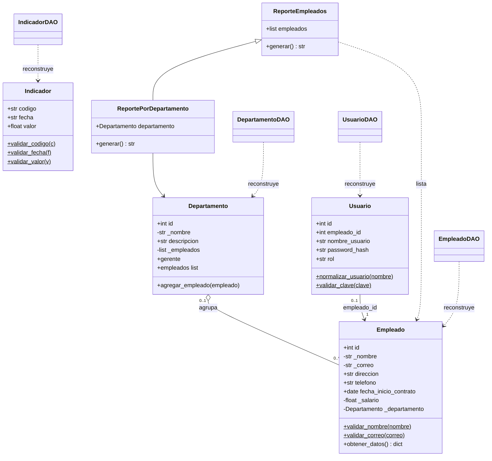

# Diagrama de clases · EcoTech (coincide con el código entregado)

Este diagrama refleja lo **realmente implementado**. `Proyecto` y `Gerente` del diseño inicial
no se implementaron (no se pedían en las clases 1–7); `Departamento.gerente` queda como atributo
reservado (`None`).

## Cómo se tradujo el modelo a Python

| Relación del modelo | Cómo se implementó |
|---|---|
| Departamento agrupa Empleados (1 a muchos) | `Departamento._empleados` (lista privada) y `Empleado.departamento` (propiedad validada); en la BD, `empleado.departamento_id` (clave foránea). |
| Usuario pertenece a un Empleado (1 a 1) | `Usuario.empleado_id`; en la BD, `usuario.empleado_id UNIQUE` con clave foránea. `Usuario` no hereda de `Empleado`. |
| ReportePorDepartamento es un ReporteEmpleados | Herencia: `class ReportePorDepartamento(ReporteEmpleados)`; ambos responden a `generar()` (polimorfismo). |
| Indicador (UF/dólar) | Objeto de dominio con clave compuesta `(codigo, fecha)` en la tabla `indicador`. |
